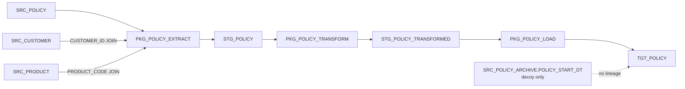

# AI 資料轉換助理：Oracle 保單轉換測試資料

## 專案目的

本專案提供完全虛構的 Oracle 保單轉換資料，作為欄位搜尋、程式碼切塊、Chunk Retrieval 與受證據限制的問答測試語料。`backend/` 包含 Spring Boot API 及可切換的 Spring AI 模型 Adapter；本專案尚未加入 Embedding、向量資料庫、Agent 或前端。

## 模擬業務背景

假設來源保單系統維護保單、客戶和商品資料。資料經抽取與清洗後，載入目標保單系統。所有識別碼、姓名及資料均為虛構。

## 系統架構



## Package 職責

| Package | 職責 | 主要 Procedure |
|---|---|---|
| `PKG_POLICY_EXTRACT` | JOIN 保單、客戶、商品來源表；欄位重新命名、日期正規化及空值處理，寫入 `STG_POLICY`。 | `RUN_EXTRACT` → `LOAD_SOURCE_TO_STAGE` |
| `PKG_POLICY_TRANSFORM` | 呼叫 Extract Package，再依狀態使用 `CASE WHEN`、`NVL` 及日期轉換，寫入 `STG_POLICY_TRANSFORMED`。 | `RUN_TRANSFORM` → `BUILD_TRANSFORMED_ROWS` |
| `PKG_POLICY_LOAD` | 呼叫 Transform Package，使用 `MERGE` 將轉換資料寫入或更新 `TGT_POLICY`。 | `RUN_FULL_LOAD` → `LOAD_TARGET` |

## 資料表關係

- `SRC_POLICY.CUSTOMER_ID` 參照 `SRC_CUSTOMER.CUSTOMER_ID`。
- `SRC_POLICY.PRODUCT_CODE` 參照 `SRC_PRODUCT.PRODUCT_CODE`。
- 抽取時以兩個 JOIN 取得客戶名稱及商品類型。
- `SRC_POLICY_ARCHIVE` 是欄位名稱相似的干擾案例，不參與流程。
- `STG_POLICY` 與 `STG_POLICY_TRANSFORMED` 分別保存抽取及轉換結果；`TGT_POLICY` 是最終目標表。

## 完整欄位血緣範例：`TGT_POLICY.EFFECTIVE_DATE`

```text
SRC_POLICY.POLICY_START_DT
  └─ PKG_POLICY_EXTRACT.LOAD_SOURCE_TO_STAGE
       └─ STG_POLICY.START_DATE
            └─ PKG_POLICY_TRANSFORM.BUILD_TRANSFORMED_ROWS
                 ├─ ACTIVE：使用 START_DATE
                 ├─ PENDING：NVL(REQUESTED_START_DATE, START_DATE + 30)
                 │    └─ REQUESTED_START_DATE ← SRC_POLICY.REQUESTED_EFFECTIVE_DT
                 └─ 其他狀態：使用 START_DATE
                      └─ STG_POLICY_TRANSFORMED.CALCULATED_EFFECTIVE_DATE
                           └─ PKG_POLICY_LOAD.LOAD_TARGET (MERGE)
                                └─ TGT_POLICY.EFFECTIVE_DATE
```

`EFFECTIVE_DATE` 的完整依賴包含 `SRC_POLICY.POLICY_START_DT`、`SRC_POLICY.REQUESTED_EFFECTIVE_DT`，以及作為分支條件的 `SRC_POLICY.POLICY_STATUS`。因此它不一定等於 `POLICY_START_DT`：PENDING 保單若有指定生效日就採用該日期，否則使用保單起始日加 30 天。`SRC_POLICY_ARCHIVE.POLICY_START_DT` 僅為相似欄名的干擾欄位，沒有實際血緣關係。

標準答案位於 `evaluation/lineage_ground_truth.json`；檢索問題位於 `evaluation/test_questions.json`。

## SQL 執行順序

使用支援 Oracle PL/SQL 的 schema，依序執行：

1. `database/01_create_tables.sql`
2. `database/02_insert_mock_data.sql`
3. `packages/PKG_POLICY_EXTRACT.pks`
4. `packages/PKG_POLICY_EXTRACT.pkb`
5. `packages/PKG_POLICY_TRANSFORM.pks`
6. `packages/PKG_POLICY_TRANSFORM.pkb`
7. `packages/PKG_POLICY_LOAD.pks`
8. `packages/PKG_POLICY_LOAD.pkb`
9. 執行 `BEGIN PKG_POLICY_LOAD.RUN_FULL_LOAD; END;`，再執行 `COMMIT;`
10. 執行 `database/03_validation_queries.sql`

Package 檔案末尾的 `/` 是常見 Oracle 用戶端（例如 SQL*Plus/SQLcl）的 PL/SQL 區塊送出符號。若使用不接受該符號的工具，請依該工具的執行方式調整。

## 測試資料

提供 12 筆保單，涵蓋 `ACTIVE`、`PENDING`、`LAPSED`，包含有／無 `REQUESTED_EFFECTIVE_DT`、空白客戶名稱，以及多種商品類型。驗證 SQL 會比較預期與實際生效日，並展示 archive 干擾資料。

## 未來用於 Spring AI + RAG

後續可將 Package Specification/Body 與 ground truth 作為檢索語料，先以欄位名稱和表名做精確檢索，再串接靜態 SQL/PLSQL 血緣分析，最後讓模型依據檢索到的程式碼證據回答 `test_questions.json`。回答應引用具體檔案、Procedure 與欄位映射，且需把資料欄位依賴和條件依賴（例如 `POLICY_STATUS`）分開呈現。此階段尚未建立 API 或 RAG。

## Spring Boot 欄位程式碼搜尋 API

`backend/` 是獨立的 Java 21、Maven、Spring Web 專案。啟動後可用 `GET /api/lineage/search?column=EFFECTIVE_DATE` 搜尋 `packages/` 下的 `.pks` 和 `.pkb`，回傳檔名、行數、匹配行及可辨識的 Procedure 名稱。搜尋不區分大小寫，並依 Oracle 識別字邊界比對；找不到時回傳空陣列。結果直接來自 Package 原始碼，不讀取 `evaluation/lineage_ground_truth.json`。

在 `backend/` 目錄執行 `mvn spring-boot:run` 啟動服務；執行 `mvn test` 跑單元測試。Chunking 與 Retrieval 預設會尋找專案內的 `packages/`；外部資料夾請設定優先使用的 `LINEAGE_PACKAGES_PATH`（舊名稱 `LINEAGE_PACKAGES_DIR` 仍相容）。欄位搜尋 API 尚未做完整 PL/SQL 語法解析、血緣推論、資料庫存取、分頁或 RAG。

### 改用公司 PCK 資料夾

後端可直接讀取外部 Package 資料夾，不需要複製或修改原始 PCK。Windows PowerShell 範例（請在專案根目錄執行，將路徑換成公司核准的唯讀程式碼目錄）：

```powershell
cd C:\Martin\project\ai-data-lineage-assistant\ai-data-lineage
$companyPackages = 'D:\Company\PACKAGES'
if (-not (Test-Path -LiteralPath $companyPackages -PathType Container)) {
    throw "Package 目錄不存在：$companyPackages"
}
$env:LINEAGE_PACKAGES_PATH = (Resolve-Path -LiteralPath $companyPackages).Path

# 先只驗證本機 Chunking / Retrieval，不呼叫任何 AI Provider。
$env:LINEAGE_ASSISTANT_PROVIDER = 'none'
$env:LINEAGE_ASSISTANT_LOG_PROMPT = 'false'
cd backend
mvn spring-boot:run
```

啟動成功後，先用 `GET http://localhost:8080/api/chunks` 確認有載入 Chunk，再用 `GET http://localhost:8080/api/retrieval/search?query=TABLE.COLUMN&limit=5` 檢查欄位檢索結果。Provider 設為 `none` 時，Chunk 與 Retrieval API 可測；`POST /api/assistant/ask` 不會呼叫模型，會回報 Provider 未設定。

掃描會遞迴處理 `.pck`、`.pkb`、`.pks`、`.sql`，副檔名不分大小寫。來源檔可混用 UTF-8（含／不含 BOM）、繁體中文 Windows ANSI（MS950／CP950，Big5 系列）及含 BOM 的 UTF-16LE／UTF-16BE。優先依 BOM 解碼；無 BOM 時先嚴格嘗試 UTF-8，再嘗試 MS950。同時合法的位元組序列優先視為 UTF-8，並非任意語系或混合編碼的自動偵測器。預設啟用容錯：最終選定編碼仍有無法解碼的位元組時，僅在記憶體中以 `�` 替代，繼續切塊，保留換行與行號；不會修復原本已損壞的文字。啟動時另以 WARN 列出 `replacementDecodedFiles` 總數、最多 5 筆檔名／解碼編碼／第一個異常位元組的零起算位置；這類檔案不因解碼替代而計入 `failedFiles`，其他讀取或解析失敗仍照常計數。包含 `�` 的問答證據也會在 API `limitations` 提醒核對。若需嚴格拒絕異常編碼，設定 `$env:LINEAGE_PACKAGES_REPLACE_INVALID_CHARACTERS = "false"` 並重新啟動。程式只讀取來源，並在啟動日誌輸出 Package 根目錄、檔案／Chunk 數、失敗數與耗時；不會把完整 PCK 寫入一般日誌。單一檔案讀取或解析失敗會列入失敗統計，其他檔案仍會繼續處理。預設上限為 20,000 個檔案、單檔 16 MB、總計 256 MB。若根目錄不存在或不可讀，後端會明確啟動失敗，不會靜默改用模擬資料。Chunking 在啟動時建立記憶體快照；新增或更新 PCK 後，需停止並重新啟動後端才會重新載入。

確認檢索結果後，若要使用問答，才設定 `LINEAGE_ASSISTANT_PROVIDER` 與相應模型設定。公司 PCK 會連同問題及檢索片段送給所選 Provider；未經公司核准前，不要選擇 OpenAI、Gemini 或 GitHub Copilot 等雲端 Provider。使用 Ollama 時也要確認 `OLLAMA_BASE_URL` 指向公司核准的本機或內部端點。公司程式碼驗證期間請保持 `LINEAGE_ASSISTANT_LOG_PROMPT=false`，避免將完整程式碼印入日誌。

要切回專案內的虛構資料，請在同一個 PowerShell 視窗回到專案根目錄並設定：

```powershell
cd C:\Martin\project\ai-data-lineage-assistant\ai-data-lineage
$env:LINEAGE_PACKAGES_PATH = (Resolve-Path .\packages).Path
```

之後重新啟動後端。若要恢復自動使用預設資料夾，也可移除外部路徑變數：`Remove-Item Env:\LINEAGE_PACKAGES_PATH -ErrorAction SilentlyContinue`；若曾設定相容舊名稱 `LINEAGE_PACKAGES_DIR`，也要一併移除。

### PL/SQL Chunk API

同一個後端也提供 `GET /api/chunks`（Chunk 摘要）及 `GET /api/chunks/{chunkId}`（完整原始程式碼）。依 `.pkb` 的具名 Procedure/Function 結尾和 `.pks` 的宣告分塊；其他無法可靠歸屬的 Package 區段標示為 `UNKNOWN`。超過 `lineage.chunking.max-lines`（預設 120 行）的 Routine 只會在完整語句結尾嘗試切分；無安全邊界時保留為較大的 Chunk，以免拆開 CASE、JOIN 或 MERGE 語句。Chunk ID 由相對檔案路徑、名稱、行範圍及原始內容計算，未修改來源時保持穩定。

```text
GET http://localhost:8080/api/chunks
GET http://localhost:8080/api/chunks/{chunkId}
```

切塊器是輕量的結構解析，不是完整 Oracle PL/SQL Parser；特殊或格式不符合具名 Routine 結構的程式會保留原文並標記 `UNKNOWN`。

### Chunk Retrieval API

`GET /api/retrieval/search?query=CALCULATED_EFFECTIVE_DATE&limit=5` 會從既有切塊器載入 Chunk，並在 Chunk 原始內容中搜尋欄位識別字。`query` 可使用單一欄位名稱或 `TABLE.COLUMN`；若為限定名稱，檢索欄位取最後一段識別字。比對不區分大小寫，且要求完整識別字邊界，因此 `EFFECTIVE_DATE` 不會因為出現在 `CALCULATED_EFFECTIVE_DATE` 內而命中。

每個結果包含完整 Chunk、命中行號及原始程式碼。`score` 是可重現的簡單規則：每個含有精確欄位識別字的行計 10 分；它不是 AI 相似度。結果依分數由高至低排序，同分時依檔名、起始行及 Chunk ID 排序。`limit` 預設為 5。檢索只使用 `packages/` 原始檔切出的 Chunk，不會讀取 `evaluation/lineage_ground_truth.json`。

```text
GET http://localhost:8080/api/retrieval/search?query=CALCULATED_EFFECTIVE_DATE&limit=5
```

### 完全離線 Retrieval 評估

在 `backend/` 執行 `mvn -Dtest=ChunkRetrievalEvaluationTest test`，會直接建立 `PlsqlChunkingService` 與 `ChunkRetrievalService`，以 `test_questions.json` 的 `related_columns` 逐題檢索，再用題目中的 `expected_source_files` 與 `lineage_ground_truth.json` 的目標欄位資訊產生評估報告。評估不會建立模型 Adapter，也不會呼叫 LLM API；標準答案只用於評估比對，不會提供給檢索服務。

報告寫入 `evaluation/retrieval_evaluation_report.json`，列出每題的查詢欄位、預期／找到／漏掉的 Package 檔案、額外檢索檔案，以及 Chunk 的 Package、Procedure、原始行號和 Chunk ID。門檻為預期 Package 證據檔案的 micro 與 macro recall 均至少 90%；precision 也會列出供檢視，但 `expected_source_files` 視為必要證據清單，可能不是完整清單。`database/*.sql` 不在現有 Package Retrieval 範圍內，會單獨列為範圍外項目。

### Spring AI 問答 API（模型需自行設定）

後端新增 `POST /api/assistant/ask`。問答服務會先依可選的 `column` 呼叫 Chunk Retrieval，再把問題與檢索到的程式碼證據交給模型；目前不支援任意自然語言語意檢索。若未提供 `column`，仍可送出問題，但沒有 PL/SQL 檢索證據，模型應回覆證據不足，且限制欄位會說明這點。

模型透過 `LineageAssistantModel` 介面抽象，目前提供 OpenAI、Gemini、Ollama 與 GitHub Copilot Adapter，共用同一套 Retrieval、提示詞、來源清單及問答流程。以 `LINEAGE_ASSISTANT_PROVIDER` 選擇 `none`、`openai`、`gemini`、`ollama` 或 `copilot`；未設定時預設 `none`，服務可啟動，問答 API 回 HTTP 503。選到的供應商才會啟用對應的模型 Adapter；OpenAI/Gemini 需要各自的 API Key，Ollama 使用本機端點與模型，Copilot 使用本機已登入的 Copilot CLI。未知 Provider 會在啟動時以不含機密的設定錯誤拒絕。

API Key 僅從環境變數讀取，不得放入 `application.yml`、原始碼或 Git。雲端模型（包括 GitHub Copilot）會收到提問與檢索到的 Chunk 內容；目前語料是虛構測試資料。連接企業程式碼前，必須先確認公司核准的模型、端點、資料處理與傳輸政策。未核准前請使用虛構 PCK 或公司核准的本機/內部模型。

如需檢視實際送給 AI Provider 的 RAG Prompt（包含檢索 Chunk、Verified Data Dependencies、Procedure Calls 與行號），可在啟動 Spring Boot 的 PowerShell 設定：

```powershell
$env:LINEAGE_ASSISTANT_LOG_PROMPT = "true"
```

應用程式會以 `INFO` 等級將完整 user prompt 記錄在後端日誌，並標示 Provider 與字元數；System Instructions 不會重複記錄。預設為 `false`。Prompt 可能包含完整 PCK 片段與使用者問題，切勿對未核准的公司程式碼開啟此功能，也請避免分享或長期保留含原始碼的日誌。關閉方式：`$env:LINEAGE_ASSISTANT_LOG_PROMPT = "false"`，然後重新啟動後端。

Provider 設定範例（PowerShell）：

```powershell
# 只選一種 Provider。請在目前終端機設定所選 Provider 需要的憑證。
$env:LINEAGE_ASSISTANT_PROVIDER = "openai"
$openAiSecret = Read-Host "OPENAI_API_KEY" -AsSecureString
$env:OPENAI_API_KEY = [System.Net.NetworkCredential]::new("", $openAiSecret).Password
Remove-Variable openAiSecret
$env:OPENAI_BASE_URL = "https://api.openai.com"
$env:OPENAI_CHAT_MODEL = "gpt-5-mini"
cd backend
mvn spring-boot:run
```

切換為 Gemini：

```powershell
$env:LINEAGE_ASSISTANT_PROVIDER = "gemini"
$geminiSecret = Read-Host "GEMINI_API_KEY" -AsSecureString
$env:GEMINI_API_KEY = [System.Net.NetworkCredential]::new("", $geminiSecret).Password
Remove-Variable geminiSecret
$env:GEMINI_BASE_URL = "https://generativelanguage.googleapis.com"
$env:GEMINI_CHAT_MODEL = "gemini-2.5-flash"
mvn spring-boot:run
```

切換為本機 Ollama（先由使用者自行準備 Ollama 服務及模型）：

```powershell
$env:LINEAGE_ASSISTANT_PROVIDER = "ollama"
$env:OLLAMA_BASE_URL = "http://localhost:11434"
$env:OLLAMA_CHAT_MODEL = "qwen3:8b"
$env:OLLAMA_THINK = "false"
ollama pull qwen3:8b
mvn spring-boot:run
```

Ollama 的 `spring.ai.ollama.init.pull-model-strategy` 設為 `never`，因此請先執行 `ollama pull qwen3:8b`。Spring AI 1.1.8 的 Ollama Chat Options 提供 `disableThinking()`；Ollama Adapter 會把這項選擇放入 ChatClient 的請求預設選項。`OLLAMA_THINK` 預設為 `false`，不依賴 Ollama CLI 的 `/set nothink` 工作階段狀態。

Ollama 的 `OLLAMA_BASE_URL` 及模型名稱、OpenAI 的 `OPENAI_BASE_URL` 及模型名稱、Gemini 的 `GEMINI_BASE_URL` 及模型名稱均可由環境變數設定。Gemini Adapter 使用 Spring AI 1.1.8 的 `GoogleGenAiChatModel` 與其相容的 Google GenAI Java SDK Client，將 `GEMINI_BASE_URL` 傳給 SDK 的 `HttpOptions`；API Key、端點與模型設定都在所選 Gemini Provider 建立時讀取。Vertex AI ADC 不在本次 API Key 模式範圍內。

### 如何取得 `COPILOT_CLI_URL`

`COPILOT_CLI_URL` 是本機 Copilot CLI headless server 的連線位址，不是 GitHub 網站網址，也不需要另外申請。啟動 CLI 時自行指定連接埠，後端就使用相同的 `localhost` 與連接埠：

```powershell
winget install GitHub.Copilot
copilot --version
copilot login
```

因此下面設定為 `http://localhost:4321`。若改用其他連接埠，例如 5000，就要同步改成 `http://localhost:5000`。如果不指定連接埠，CLI 會挑選可用連接埠並印出 Listening URL，請將該網址填入環境變數。預設只接受本機 loopback 連線，不要加 `--host 0.0.0.0` 對外開放。GitHub 官方的 [Backend services setup](https://docs.github.com/en/copilot/how-tos/copilot-sdk/setup/backend-services) 說明 headless server 的連接埠與 SDK URL 對應方式。

### 如何取得 `COPILOT_CHAT_MODEL`

先完成 `copilot login`，再於另一個終端機執行 `copilot` 開啟互動式 CLI，輸入 `/model`（部分 CLI 版本也支援 `/models`）查看此帳號目前可以選擇的模型。從清單複製模型的 **ID**，不是顯示名稱；把它填入 `COPILOT_CHAT_MODEL`。清單內容會依 Copilot 方案、帳號與組織政策不同，某個文件範例或網路上的模型名稱不保證你的帳號可用。GitHub 官方文件說明 `/model` 可查看並選擇可用模型，SDK 也提供 `CopilotClient.listModels()` 取得模型 ID 與名稱：[CLI model selection](https://docs.github.com/en/copilot/reference/copilot-cli-reference/cli-programmatic-reference)、[Java SDK model list](https://github.com/github/copilot-sdk-java/blob/main/src/site/markdown/documentation.md)。

取得模型 ID 後，離開互動式 CLI，在另一個 PowerShell 視窗啟動 headless server，固定使用 4321 並保持該視窗執行：

```powershell
copilot --headless --port 4321
```

在第三個終端機啟動後端；將 `<從 /model 清單複製的模型 ID>` 換成你帳號可用的實際 ID：

```powershell
$env:LINEAGE_ASSISTANT_PROVIDER = "copilot"
$env:COPILOT_CLI_URL = "http://localhost:4321"
$env:COPILOT_CHAT_MODEL = "<從 /model 清單複製的模型 ID>"
$env:COPILOT_TIMEOUT_SECONDS = "60"
cd backend
mvn spring-boot:run
```

此 Provider 使用 GitHub 官方 `com.github:copilot-sdk-java:1.0.22`（Java SDK 目前仍為 Public Preview），連線到外部管理的本機 CLI server。每次請求建立隨機隔離 Session 並在結束後刪除；Session 不提供工具、MCP 或自訂 Agent，停用設定／指令探索，並拒絕所有權限請求。CLI 不可用或未登入時，問答 API 會回報 Provider 錯誤；`GET /api/assistant/provider` 顯示啟動時選定的 Provider 與模型設定狀態，不會代替 CLI 登入健康檢查。CLI server 不要暴露到公網。Copilot 使用雲端模型處理送出的問題與檢索 PCK 片段，請先確認組織政策允許。

呼叫範例：

```http
POST http://localhost:8080/api/assistant/ask
Content-Type: application/json

{
  "question": "EFFECTIVE_DATE 的來源與轉換規則是什麼？",
  "column": "EFFECTIVE_DATE"
}
```

成功回應包含 `answer`、`sources` 和 `limitations`。`sources` 由後端依實際檢索 Chunk 建立，提供 `citationId`（例如 `[S1]`）、Package、Procedure、檔名、行範圍與命中行；模型僅被要求使用這些來源代號，不會生成 API 的來源清單。模型提示也要求忽略程式碼內的指令文字，只根據檢索證據回答。這些提示不能構成形式化保證，因此回答仍應對照回傳來源核驗。沒有設定模型時，API 回傳 HTTP 503 Problem Detail。

本專案使用 Spring Boot `3.5.16`、Java 21 及 Spring AI `1.1.8` BOM。Spring AI 官方相容性說明列出 1.1.x 對應 Spring Boot 3.5.x；Maven 依賴為 `spring-ai-starter-model-openai`、`spring-ai-starter-model-google-genai` 與 `spring-ai-starter-model-ollama`，版本由 1.1.8 BOM 管理。Provider 切換測試、模型設定測試及問答錯誤處理測試不呼叫真實模型服務，也不需要真實 API Key。

## 驗證狀態與限制

本專案提供 12 筆資料與可手動執行的驗證查詢。若目前環境未連接 Oracle，不能據此宣稱 SQL/PLSQL 已在 Oracle 實際編譯或執行；部署到不同 Oracle 版本或用戶端前仍應執行編譯及驗證腳本。

## Vue 3 聊天介面

`frontend/` 提供 Vue 3、Vite、TypeScript 與 Composition API 聊天 UI。左側保留本機對話紀錄，中間呼叫既有問答 API，右側讀取並顯示完整 Chunk 原始程式碼，並標示後端回傳的 `matchedLines`。回答以 Markdown 顯示並經過 HTML 消毒。對話暫存在瀏覽器 `localStorage`，不會寫入後端資料庫。

Provider 區讀取唯讀 `GET /api/assistant/provider`，顯示後端實際選擇的 Provider、模型與設定狀態。選擇器刻意鎖定，Provider 仍由啟動後端時的 `LINEAGE_ASSISTANT_PROVIDER` 決定；前端沒有模型切換功能，也不存放 API Key。此唯讀端點不回傳憑證或模型端點。若需要執行階段切換，必須另行設計具備授權、切換政策、執行中請求處理與 Provider 憑證管理的後端功能，本版不包含該能力。

先在一個終端機啟動後端：

```powershell
cd backend
mvn spring-boot:run
```

再開另一個終端機啟動前端：

```powershell
cd frontend
npm install
npm run dev
```

瀏覽器開啟 `http://localhost:5173`。Vite 開發伺服器會將 `/api` 請求代理到 `http://localhost:8080`；後端位址可用 `VITE_BACKEND_URL` 覆寫。可在 VS Code 命令面板執行「Tasks: Run Task」，分別啟動 `啟動 AI Data Lineage Backend` 與 `啟動 AI Data Lineage Frontend`。前端單元測試與正式建置：

```powershell
npm run test
npm run build
```

目前前端以 Vite 開發伺服器提供，尚未設定 Spring Boot 靜態檔案整合或正式部署流程。

## 欄位規格分析：情境、檢核條件與資料檢核 SQL 草稿

前端預設選擇「欄位規格：情境、條件與檢核 SQL」，輸入必填欄位及想聚焦的問題後送出；原本「一般問答」仍使用 `/api/assistant/ask`。欄位規格分析使用獨立 API：

```http
POST /api/assistant/analyze-field
Content-Type: application/json

{
  "column": "TGT_POLICY.EFFECTIVE_DATE",
  "question": "逐情境整理欄位用途、外層及內層檢核條件、來源值與沿用或改寫方式，附原始碼行號，並整理可確認的資料檢核 SQL 草稿。"
}
```

### 分析內容

- 情境總結：何時、如何取得／沿用／計算、由誰寫入何處；保留不同分支，連回明細來源。
- 規則明細表：欄位、使用方式、原始條件與中文解釋、來源值與轉換、寫入位置、Package／Procedure／行號／原始碼、程式效果與待確認項目。
- 條件包含外層 IF／ELSIF／ELSE、CASE、WHERE／JOIN、NVL 及相關被呼叫程序；區分觸發條件、資料篩選與欄位合法性檢核。
- 整筆 record、cursor、參數與讀寫程序也納入候選脈絡。若 record 型別、caller 實參／callee 形參、欄位映射或寫回鏈缺乏證據，必須標示待確認，不能僅憑整筆複製就宣稱沿用或完整血緣。
- 資料檢核 SQL 只產生有證據支持的唯讀 SELECT 草稿，不自動執行。不能把來源 WHERE 直接當作目標表的全域限制、以少數賦值推論完整允許值，或臆造 JOIN key。

### 證據收集與範圍

此流程不套用一般問答的 Top K=8，而是盤點已載入語料中的欄位識別字命中，以及既有 Dependency Analyzer 可追到的 Chunk。`TABLE.COLUMN` 的字面欄位候選仍可能包含其他表同名欄位或註解；這些是供核對的候選，不是已驗證血緣。接著有界展開兩層直接呼叫關係，最多 256 條邊，加入 caller／callee 完整 Routine 及所在檔案未歸屬區段，以保留條件和 record 宣告。未具名／未解析程序、overload、動態 SQL、其他型別的間接引用仍可能漏查，本版不是完整 Oracle 語意分析器。

同一檔案同一 Routine 的所有 Chunk 一起分批，過長的完整區段會明確列為未分析，不裁掉 IF/ELSE 或 SQL 中間部分。每批獨立呼叫 Provider，完成後再以另一個模型請求整理情境總結；所有逐批明細仍保留。來源和呼叫代號會映射成整份報告一致的 `[S#]`／`[C#]`，不存在的代號會標為無效引用。這只驗證代號存在，不保證模型敘述或行號主張已被形式化驗證。

API 保留 `answer`／`sources`／`limitations`，另提供 `coverage` 與 `batches`。`coverage` 列出掃描／讀取／失敗檔案數、字面命中／候選／已分析／未分析 Chunk 數、成功／失敗批數及彙整是否包含全部批次草稿。未載入語料及未支援語法仍須核對，即使所有候選都分析完，狀態仍為 `DRAFT`。批次 Provider 失敗時保留其他成功明細及來源；Provider 未設定時回 503。沒有證據或所有完整區段都超過預算時不呼叫模型。

### 模型輸入預算

```powershell
$env:LINEAGE_FIELD_ANALYSIS_MAX_INPUT_CHARS = "24000"
$env:LINEAGE_FIELD_ANALYSIS_MAX_BATCHES = "8"
$env:LINEAGE_FIELD_ANALYSIS_MAX_SUMMARY_CHARS = "16000"
```

以上為預設值。每批預算包含 system instructions、使用者問題、帶行號原碼及呼叫／依賴資訊；是字元限制，不是 tokenizer 精確 token 限制。最多 8 個明細請求加 1 次總結請求，會比一般問答花更多模型時間／用量。中間草稿若超過彙整預算，整批不放入總結並明確列出，原明細仍保留。欄位總結由模型草稿再整理，不能視為人工核實結果；正式使用前需以核准的模型和真實 PCK 做逐項驗收。
